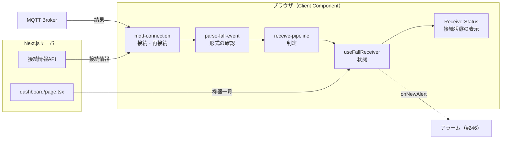
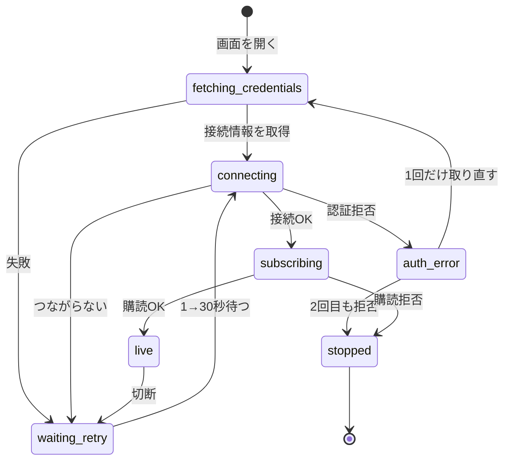
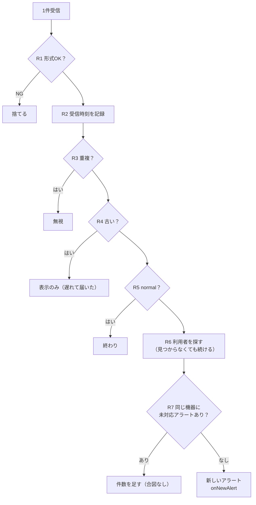

# AI判定結果の受信 詳細設計（Web）

更新日：2026-11-26 ／ 対象：[Issue #245](https://github.com/CCCproject2026/ccc_project_2026/issues/245)

## 1. 概要

**ダッシュボード（`/dashboard`）のブラウザが、AIの判定結果をMQTT over WebSocketで直接受け取り、確かめて、fallなら未対応アラートにする。** 本書はこの「受ける側」だけを定める。

| 項目 | 内容 |
| --- | --- |
| 対象 | Brokerへの接続、受信メッセージの検証、重複・古さの判定、利用者の特定、未対応アラートの作成、接続状態の表示、それを支えるサーバー側 |
| 対象外 | アラーム音・対応記録（#246）、画面間の同期、AI側の送信（#197）、BrokerのTLS・ACL（インフラ）、DBの変更 |
| 根拠 | [Web基本設計](../../basic_design/web_basic.md)、AI詳細設計[02](../ai-server/02_MQTT・Device詳細設計.md)・[05](../ai-server/05_Result・Web連携詳細設計.md)・[06](../ai-server/06_Error・Log・Config詳細設計.md)・[07](../ai-server/07_Batch_Input実装.md)、[mosquitto.conf](../../../main/broker/mosquitto.conf) |

### 必ず守るルール

1. AIの結果は転倒の**可能性**。受信だけで転倒を確定せず、対応記録も自動で作らない。
2. 結果はWebサーバーを通さず、DBにも保存しない。
3. `normal` を受けてもアラートを消さない。
4. 結果が届かないことを「異常なし」と表示しない。
5. 利用者が分からなくても、fallは捨てずに表示する。
6. Brokerの管理者資格情報や、AI・Device用の秘密情報をブラウザに渡さない。

### 注意

- AI側の結果送信は**まだ実装されていない**。3章の形式は合意前の案。
- [Broker基本設計](../../basic_design/mqtt-broker.md) 4章は「Retainあり・FallLogに保存」で、本書と逆。改訂が必要（11章 U1）。

## 2. 構成

受信の処理はすべてブラウザで行う。サーバーは「接続情報」と「機器 → 利用者の一覧」を渡すだけ。



新しいファイルは `main/web/src/features/realtime/` にまとめる（案）。

| ファイル | 役割 |
| --- | --- |
| `types.ts` | 型（6章） |
| `client/mqtt-connection.ts` | MQTT.jsで接続・購読・再接続。Reactに依存しない |
| `client/parse-fall-event.ts` | TopicとJSONの検証（zod） |
| `client/receive-pipeline.ts` | 判定 R2〜R7。副作用のない関数 |
| `client/useFallReceiver.ts` | 接続と判定をつなぎ、状態を持つhook |
| `components/FallReceiverProvider.tsx` | `"use client"`。状態を画面に配る |
| `components/ReceiverStatus.tsx` | 接続状態と最後の受信時刻 |
| `server/device-directory.ts` | 機器 → 利用者の一覧をDBから作る |
| `server/broker-credentials.ts` | ブラウザ用の接続情報を作る |
| `src/app/api/realtime/credentials/route.ts` | 接続情報API |
| `src/app/(authenticated)/dashboard/page.tsx`（既存） | 機器一覧を取ってProviderに渡す |

**追加する依存**: `mqtt`（MQTT.js）だけ。PRで理由と `pnpm-lock.yaml` への影響を説明する。検証は既存の `zod` を使う。

## 3. 受信するメッセージ

| 項目 | 値 |
| --- | --- |
| Topic | `fall/+/events` を購読 |
| QoS | 1。同じ結果が2回届くことがある → 重複を消す（R3） |
| Retain | AIは付けない。Retain付きで届いたら過去の結果として扱う（R4） |
| 頻度 | 機器ごとに約2秒ごとに2件（fallもnormalも）。1回の転倒でfallが続けて届く → 1つのアラートにまとめる（R7） |

```json
{
  "event_id": "6f1c2a9e-3b4d-4e8f-9a01-2c3d4e5f6a7b",
  "device_code": "ESP32-001",
  "result": "fall",
  "detected_at": "2026-11-23T01:02:05.000Z",
  "model_version": "sisfall-a7d4589b1542-8bc81b30acf3"
}
```

| 項目 | 必須 | 意味 |
| --- | --- | --- |
| `event_id` | 推奨 | 結果ごとのUUID。再送でも同じ値 |
| `device_code` | ○ | 機器コード。Topicの機器コードと同じ |
| `result` | ○ | `fall` か `normal` |
| `detected_at` | ○ | 判定に使ったWindowの最後の計測時刻（UTC、機器の時計） |
| `model_version` | ○ | モデルの版 |

### 検証ルール（R1）

次のどれかに当てはまったら捨て、理由ごとに件数を数える。本文はログに出さない。知らない項目は無視する。

| # | 捨てる条件 |
| --- | --- |
| V1 | Topicが `fall/{device_code}/events` の形でない |
| V2 | 本文が4 KiBを超える、またはJSONオブジェクトでない |
| V3 | 本文とTopicの `device_code` が違う（大文字・小文字も区別） |
| V4 | `result` が `fall`・`normal` 以外（知らない値をnormalとみなさない） |
| V5 | `detected_at` がタイムゾーン付きの日時でない |
| V6 | `model_version` が空、または64文字を超える |
| V7 | `event_id` があるのにUUIDでない |

```ts
// client/parse-fall-event.ts（案）
const TOPIC = /^fall\/([A-Za-z0-9_-]{1,64})\/events$/;

const FallEventSchema = z.object({
  event_id: z.string().uuid().optional(),
  device_code: z.string().regex(/^[A-Za-z0-9_-]{1,64}$/),
  result: z.enum(["fall", "normal"]),
  detected_at: z.string().datetime({ offset: true }),
  model_version: z.string().min(1).max(64),
});
```

## 4. 接続

タブ1つにつき接続は1本。切れたらつなぎ直すが、切れていた間の結果は取り戻さない。



| 設定 | 値 | 理由 |
| --- | --- | --- |
| URL | 開発 `ws://localhost:9001`、本番 `wss://…`（443）。接続情報APIから受け取る | 本番はTLSだけ |
| MQTTの版 | 3.1.1 | AI側と同じ |
| clean session | true | 切断中の結果をためない |
| client_id | `web-<ランダム>`（タブごと） | 同じIDだと他のタブが切られる |
| keepalive | 60秒 | AI側と同じ |
| 再接続 | 1→2→4→8→16→30秒。MQTT.jsの自動再接続は使わない（`reconnectPeriod: 0`） | 待ち時間を自分で管理する |
| つながり直したとき | `router.refresh()` で機器一覧も取り直す | 割当の変更を反映 |
| 画面を閉じたとき | `client.end()` | 接続を残さない |

## 5. 受信の処理

1件ごとに R1〜R7 を順に通す。**アラームの合図が出るのは、全部を通った新しいfallだけ。**



| # | 処理 | ルール |
| --- | --- | --- |
| R1 | 形式の確認 | 3章のV1〜V7 |
| R2 | 受信時刻の記録 | fallでもnormalでも、全体と機器ごとの「最後の受信」を更新 |
| R3 | 重複 | 重複キー = `event_id`（無ければ `device_code + detected_at + model_version`）。10分・最大5,000件覚える |
| R4 | 古さ | Retain付き、`今 − detected_at` が10秒超、または60秒以上未来なら古い |
| R5 | normal | ここで終わり。アラートは消さない |
| R6 | 利用者 | `detected_at` の時点で有効な割当を探す。無ければ「未割当」 |
| R7 | まとめ | 同じ機器の未対応アラートがあれば件数と最後の検知時刻を更新。無ければ新しく作る |

- 結果は順番どおりに届かないことがある。並びは受信順ではなく `detected_at` で決める。
- **時計のずれ**: R4は機器の時刻とPCの時刻を比べる。PCの時計がずれるとアラームが鳴らなくなるため、PCのNTP同期を前提にする。10秒超が同じ機器で3件続いたら「PCの時計がずれている可能性があります」と表示する。
- 10秒・10分・5,000件・3件は案。定数として `receive-pipeline.ts` にまとめる。

## 6. 型

状態はすべてブラウザのメモリ上に持つ。`useFallReceiver` が `useReducer` で持ち、`receive-pipeline.ts` で次の状態を作る。

```ts
// types.ts（案）

/** 検証済みの1件 */
export type FallEvent = {
  dedupeKey: string;      // event_id、または代わりのキー
  deviceCode: string;
  result: "fall" | "normal";
  detectedAt: Date;
  modelVersion: string;
  retained: boolean;
  receivedAt: Date;
};

/** 未対応アラート */
export type UnhandledAlert = {
  alertId: string;        // 最初のfallの dedupeKey
  deviceCode: string;
  elder: { id: string; name: string; room: string } | null; // null = 未割当
  firstDetectedAt: Date;
  lastDetectedAt: Date;
  fallCount: number;
  late: boolean;          // R4で古いと判定した
};

/** 機器の割当（サーバーから受け取る） */
export type DeviceAssignmentEntry = {
  deviceCode: string;
  elderId: string;
  elderName: string;
  roomNumber: string;
  assignedAt: string;     // ISO 8601
  unassignedAt: string | null;
};
```

## 7. サーバー側

どちらもログイン中の**ACTIVEなスタッフ**にだけ返す。DBの変更はない。

### 7.1 接続情報API `GET /api/realtime/credentials`

| 項目 | 内容 |
| --- | --- |
| 認証 | handlerで `requireStaff()`。`middleware.ts` では公開ルートにし、401をhandlerで返す（`/api/staff` と同じ） |
| 200 | `{ "url": "wss://…", "username": "…" \| null, "password": "…" \| null }`（開発は匿名なのでnull） |
| 401 / 403 / 503 | 未ログイン / 無効なスタッフ / 接続先が未設定 |
| ヘッダー | `Cache-Control: no-store` |
| 環境変数 | `MQTT_BROWSER_WS_URL`・`MQTT_BROWSER_USERNAME`・`MQTT_BROWSER_PASSWORD`。`NEXT_PUBLIC_` にしない |

### 7.2 機器 → 利用者の一覧

`dashboard/page.tsx` が `getDeviceDirectory()` を呼び、propsで渡す。新しいAPIは作らない。割当が外れた直後の結果にも対応するため、直近10分に外れた割当も含める。渡すのは名前と部屋だけ。

```ts
// server/device-directory.ts（案）
const since = new Date(Date.now() - 10 * 60 * 1000);
const rows = await prisma.deviceAssignment.findMany({
  where: { OR: [{ unassignedAt: null }, { unassignedAt: { gt: since } }] },
  select: {
    assignedAt: true,
    unassignedAt: true,
    device: { select: { deviceCode: true } },
    elder: { select: { id: true, firstName: true, lastName: true, roomNumber: true } },
  },
});
```

## 8. 画面表示とエラー

「つながっているか」と「最後にいつ受け取ったか」を分けて表示する。色だけでなく文字でも示す。

| 状態 | 表示 |
| --- | --- |
| 接続中（`fetching_credentials`・`connecting`・`subscribing`） | 接続中…（グレー） |
| `live` | 受信中（緑） |
| `waiting_retry` | 切断中。○秒後に再接続。この間の結果は届きません（黄） |
| `stopped` | 接続できません。管理者に連絡してください（赤） |
| 接続情報APIが401 | ログインしてください |

- 「最後の受信」は全体と機器ごとに出す（例: 10:02:05（3秒前））。まだ無ければ「未取得」。
- 機器からデータが来ないとき、AIは何も送らない。結果が来なくても「異常なし」「AI停止」とは表示しない。
- アラートの文言は「転倒の可能性」。未割当は「未割当の機器（ESP32-001）」、古いものには「遅れて届いた」の印を付ける。
- 受信処理で予想外のエラーが出たら、その1件だけ捨てて接続は続ける。

### ログとセキュリティ

- ログに出すのは状態の変化と「捨てた理由・件数」だけ。受信した本文・パスワードは出さない。
- ブラウザ用アカウントは `fall/+/events` の購読だけ許可する（ACL）。送信や `fall/+/data` の購読はさせない。
- 本番は `wss://` だけ。開発の匿名設定を本番で使わない。
- 受信した文字列をHTMLとして表示しない。

## 9. テスト

`main/web` にはテストランナーがないので、静的チェックと手動確認で検証する。

- 静的チェック: `pnpm lint`、`pnpm biome:check`、`pnpm build`
- 手動確認: `docker compose up mqtt-broker` でBrokerを起動し、合成データを送る（実利用者のデータは使わない）。

```bash
docker compose exec mqtt-broker mosquitto_pub -q 1 -t fall/ESP32-001/events \
  -m '{"event_id":"6f1c2a9e-3b4d-4e8f-9a01-2c3d4e5f6a7b","device_code":"ESP32-001","result":"fall","detected_at":"<今のUTC時刻>","model_version":"test"}'
```

| # | やること | 期待する結果 |
| --- | --- | --- |
| T1 | 割当済みの機器でfall | 利用者名付きのアラートが1件、合図が1回 |
| T2 | 同じ結果をもう一度（`event_id` あり／なし） | 増えない |
| T3 | 同じ機器で別のfall | 同じアラートの件数が2。合図なし |
| T4 | normal | 最後の受信時刻だけ更新。アラートは残る |
| T5 | 1分前の `detected_at`、またはRetain付き（`-r`）のfall | 「遅れて届いた」。合図なし |
| T6 | 未割当の機器でfall | 「未割当」のアラート |
| T7 | 機器コード不一致・壊れたJSON・知らない `result` | 表示されず、捨てた件数が増える |
| T8 | 2件を新しい順に連続で送る | `detected_at` の順に並ぶ |
| T9 | Brokerを止めて、また動かす | 切断中 → 受信中。機器一覧を取り直す |
| T10 | 2つのタブで開く | 両方に届き、互いに切れない |
| T11 | 未ログイン・無効スタッフで接続情報API | 401 / 403 |
| T12 | コンソールとサーバーログを見る | 本文・パスワードが出ていない |

T5でRetainを使ったら、`mosquitto_pub -r -n -t fall/ESP32-001/events` で必ず消す。実際のAIとの結合確認は #202 で行う。

## 10. 未決事項

実装前に #192 の合意内容を確認する。「AI側の見解」はレビューで出た意見で、合意ではない。

| # | 決めること | 本書の案 | AI側の見解 | 相手 |
| --- | --- | --- | --- | --- |
| U1 | Topic・QoS・Retain | `fall/+/events`・1・なし | この形で送る予定。Broker基本設計の改訂が必要 | AI・インフラ |
| U2 | `event_id` | 入れる | 賛成（#197で実装） | AI |
| U3 | `detected_at` の意味 | Windowの最後の計測時刻 | 賛成 | AI・IoT |
| U4 | 古さ・重複・時計ずれの基準 | 10秒・10分・5,000件・3件 | 10秒で足りる見込み | AI・Web |
| U5 | `WINDOW_STEP`（結果の頻度） | 50（約2秒ごとに2件） | 開発用の候補値 | AI・IoT |
| U6 | 機器の通信状態・AIの稼働の通知 | 本書では扱わない | Topicは未決 | AI・IoT・Web |
| U7 | ブラウザのBroker認証 | デモは共通の読み取り専用アカウント、本番はログインごとの短期資格情報 | — | インフラ |
| U8 | Brokerの置き場所（設計はEC2、Webは今Heroku） | — | — | インフラ |
| U9 | MQTT.jsの採用 | 採用 | — | Web |
