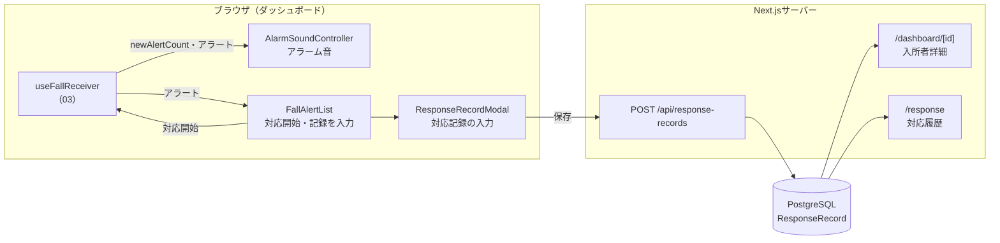
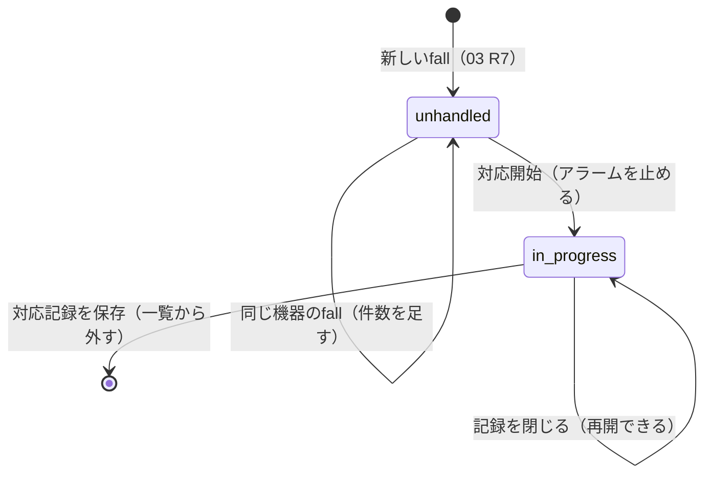

# アラーム・対応記録 詳細設計（Web）

更新日：2026-11-27 ／ 対象：Issue #246（アラーム音・対応記録） ／ 実装ブランチ：`test/ai_api` ／ 前提：[03 AI判定結果の受信](./03_AI判定結果の受信詳細設計.md)

## 1. 概要

**03で受け取った「転倒の可能性」に、スタッフが対応するまでを定める。** アラーム音を鳴らし、「対応開始」で止め、対応内容と「実際の転倒だったか」を対応記録としてDBに保存する。保存した記録は、入所者詳細と対応履歴の画面で見られる。

| 項目 | 内容 |
| --- | --- |
| 対象 | アラーム音、アラートの状態（未対応・対応中）、対応記録の入力と保存、入所者詳細（`/dashboard/[id]`）、対応履歴一覧（`/response`） |
| 対象外 | 画面間・スタッフ間の状態の共有と同時対応の制御、申し送り、対応記録の編集・削除、DBの変更 |
| 根拠 | [Web基本設計](../../basic_design/web_basic.md)「アラートと対応操作」「対応記録・申し送りの投稿」「画面一覧」、[schema.prisma](../../../main/web/prisma/schema.prisma) の `ResponseRecord`、migration `20261019070000_restore_constraints` |

### 必ず守るルール

1. AIの結果は転倒の**可能性**。対応記録はスタッフが入力し、自動では作らない（03 ルール1）。
2. AIの判定結果はDBに保存しない（03 ルール2）。DBに入るのは、スタッフが保存した対応記録だけ。
3. 鳴らせない・届かない状態を隠さない。音が出せないときは画面に文字で出す。
4. 投稿者（`staffId`）と記録完了時刻（`completedAt`）はサーバーで付ける。画面からは受け取らない。
5. 対応内容（メモ）はログに出さない。

## 2. 構成

| ファイル | 役割 |
| --- | --- |
| `features/alarm/client/alarm-sound.ts` | Web Audio API で音を作って鳴らす。Reactに依存しない |
| `features/alarm/components/AlarmSoundController.tsx` | 合図で鳴らす・止める。鳴らせないときの警告 |
| `features/realtime/components/FallAlertList.tsx` | アラートの一覧、「対応開始」「記録を入力」、入力途中の内容の保持 |
| `features/response/schemas/response-record-input.ts` | 対応記録の入力（zod）。画面とサーバーで共通 |
| `features/response/api/response-records.ts` | ブラウザから保存APIを呼ぶ |
| `features/response/components/ResponseRecordModal.tsx` | 対応記録の入力モーダル |
| `features/response/server/response-record-service.ts` | 対応記録を保存する |
| `features/response/server/response-history-service.ts` | 全員分の対応記録の一覧・件数 |
| `features/response/pages/ResponseHistoryPage.tsx` | 対応履歴一覧の画面 |
| `features/dashboard/server/dashboard-service.ts`（既存） | `getResidentActivity` を追加（入所者詳細の機器・履歴・件数） |
| `features/dashboard/[id]/pages/ResidentDetailPage.tsx`（既存） | 入所者詳細の画面 |
| `features/dashboard/[id]/components/DeviceStatusPanel.tsx`（既存のモック） | 実データにつなぐ |
| `features/dashboard/components/ResponseHistoryTable.tsx`（既存のモック） | 実データにつなぐ。「入所者」列を任意で出す |
| `src/app/api/response-records/route.ts` | 保存API |
| `src/app/(authenticated)/response/page.tsx` | `src/app/response/` から移動。layout の認可とサイドバーを使う |
| `shared/lib/date.ts`（既存） | `formatSlashDateTime`・`formatDuration` を追加 |
| `shared/layout/sidebar/Sidebar.tsx`・`TopBarClient.tsx`（既存） | 「対応履歴」メニュー、入所者詳細のタイトル |

追加した依存はない。音は音声ファイルを使わず Web Audio API で作る（ライセンス・読み込み失敗の心配がない）。

## 3. アラームの状態と対応操作

基本設計「アラートと対応操作」に合わせる。

| 状態 | 画面の印 | 内容 |
| --- | --- | --- |
| `unhandled` | 未対応（赤） | 同じ機器の新しいfallはここにまとめる（03 R7） |
| `in_progress` | 対応中（青） | 「対応開始」を押した。同じ機器の新しいfallは**別のアラート**になり、もう一度鳴る |
| 保存済み | 一覧から外す | 対応記録（転倒 / 誤検知）はDBに残る |

- 「対応開始」の時刻は最初に押した時刻を残す。2回目は変えない。
- 状態はそのタブのメモリだけに持つ。再読み込み・画面を離れると、記録していない「対応中」も消える（9章 U1）。

## 4. アラーム音

| 項目 | 内容 |
| --- | --- |
| 鳴らす条件 | 03の合図（`newAlertCount` が増えた）。重複・まとめ・遅れて届いたものでは鳴らさない |
| 音 | 880 Hz と 660 Hz の矩形波を0.3秒ずつ（「ピー・ポー」）、1.5秒ごとにくり返す。音量0.3 |
| 止める | 未対応のアラートが0件になったとき（「対応開始」）、または「アラームを止める」。アラートは消さない |
| もう一度鳴る | 止めた後でも、新しいアラートの合図で鳴る |
| 表示 | 鳴動中は赤いバー「アラーム鳴動中」を `sticky top-0 z-[60]` で出す。記録の入力モーダル（z-50）より手前に出し、入力中でも止められる |

### 鳴らせないとき（ルール3）

ブラウザは、画面を一度も操作していないと音を出させない（自動再生の制限）。OS が音声を止めることもある。

| 状況 | 表示 |
| --- | --- |
| まだ一度も操作していない | 黄色「アラーム音が無効です」と「アラーム音を有効にする」ボタン |
| 鳴らすべきなのに鳴らせない | 赤「新しいアラートがありますが、アラーム音を鳴らせません」 |

- `pointerdown`・`keydown` で `AudioContext.resume()` を呼ぶ。listener は外さず、一度有効にした後も止まったら再び有効にする。
- `AudioContext.onstatechange` で状態を見張る。止まったら警告に切り替え、有効になれば鳴り続きから再開する。
- 鳴るのは画面を開いている間だけ。閉じたタブ・スリープ中のPC・消音のPCでは鳴らない。

## 5. 対応記録の保存 `POST /api/response-records`

| 項目 | 内容 |
| --- | --- |
| 認証 | handlerで `requireStaff()`（CAREGIVER・NURSE の両方）。`middleware.ts` では `/api/response-records` を公開ルートにし、401をhandlerで返す |
| 本文 | `{ "elderId": "…", "content": "…", "isActualFall": true, "elapsedMs": 72000 }` |
| 201 | `{ "id": "…", "completedAt": "ISO 8601" }` |
| 400 / 401 / 403 / 404 | 入力不正 / 未ログイン / 無効なスタッフ / 在籍中の高齢者が見つからない |
| エラー本文 | `{ code, message }`（`errorResponse`。スタッフ管理APIと同じ形） |

| 項目 | ルール | DBとの対応 |
| --- | --- | --- |
| `elderId` | 1〜64文字。在籍中（`ACTIVE`）の高齢者だけ | `elderId` |
| `content` | 前後の空白を除いて1〜2,000文字 | CHECK `length(btrim(content)) > 0` |
| `isActualFall` | 必須の真偽値（false = 誤検知） | `isActualFall` |
| `elapsedMs` | 「対応開始」から保存までのミリ秒。0〜24時間の整数 | `responseStartedAt = completedAt − elapsedMs` |
| `completedAt` | サーバーの現在時刻 | CHECK `responseStartedAt <= completedAt` は構造上必ず守られる |
| `staffId` | ログイン中のスタッフ。本文に入れても使わない | `staffId` |

- **時刻ではなく経過時間を送る理由**: ブラウザの時計の時刻を送ると、PCの時計のずれがそのまま入り、進んでいると保存できなかった（レビュー指摘 L2）。
- DBの変更はない。`ResponseRecord` は初期 migration から存在し、`release: prisma migrate deploy` で新しく適用するものはない。

## 6. 対応記録の入力画面

基本設計は `/alerts/[id]` の別画面としているが、**ダッシュボード上のモーダル**にした（8章 D1）。

| 項目 | 内容 |
| --- | --- |
| 開く | 「対応開始」を押すと開く。閉じても「対応中」のまま残り、「記録を入力」で再開する |
| 入力 | 実際の転倒でしたか（はい / いいえ（誤検知））、対応内容・メモ（必須、2,000文字まで、文字数を表示） |
| 対象の高齢者 | 割当済みならその人。未割当の機器では、在籍中の高齢者を名前・部屋番号で検索して選ぶ（`GET /api/elders?status=ACTIVE`、100件まで） |
| 404のとき | 割当の高齢者が退所済みなど。選び直せるようにする |
| 入力途中の内容 | アラートごとに親（`FallAlertList`）が持つ。閉じて開き直しても、別のアラートを先に対応しても消えない。保存したら消す |
| 保存後 | アラートを一覧から外し、「対応記録を保存しました」と出す |

### 失敗時の案内

| 失敗 | 案内 | 入力内容 |
| --- | --- | --- |
| 400・404 | サーバーのメッセージ（例: 対象の高齢者が見つかりません） | 残す |
| 401 | ログインしてください | 残す |
| 通信断・502・503・504 | 保存できたか確認できない。二重の記録を防ぐため、すぐに保存し直さず確認する | 残す |

- **二重送信**: 保存中はボタンを無効にする。保存結果が分からない失敗（Herokuの30秒の時間切れなど）では「もう一度保存」と案内しない（レビュー指摘 M3）。完全に防ぐにはDBの変更が要る（9章 U2）。
- **フォーカス**: モーダルに渡す関数は `useCallback` で固定する。受信のたびに一覧が再描画され、関数が変わると `Modal` がフォーカスを「閉じる」ボタンへ戻し、入力中の文字が消えていた（レビュー指摘 H1）。
- 検索欄で Enter を押しても保存しない。

## 7. 対応記録の表示

どちらも Server Component でDBから読み、`requireStaffPage()` で認可する（layout だけに頼らない）。

### 7.1 入所者詳細 `/dashboard/[id]`

| 部分 | 内容 |
| --- | --- |
| 入所者情報 | 名前・年齢・居室番号・生年月日と、対応記録の **転倒 / 誤検知 / 合計** の件数 |
| デバイス状態 | 割当中の機器のコード・名前・利用状態（有効 / 停止中）。無ければ「デバイス未割当」 |
| 対応履歴ログ | 対応開始・記録完了・所要時間・転倒判定・対応スタッフ・状況メモ。新しい順に50件 |

- 機器・履歴・件数は `prisma.$transaction([...])`（一括）で読む。対話型トランザクションではないので、5秒の時間切れにならない。
- **バッテリー残量・最終通信は「未連携」と表示する**。機器から Web へ届く仕組みとDBの列が無い。値を作ると、電池切れの機器を正常に見せてしまう。
- 「オンライン」ではなく「利用状態」とする。DBにあるのは登録上の有効・停止で、通信できているかは分からない。

### 7.2 対応履歴 `/response`

| 部分 | 内容 |
| --- | --- |
| 件数 | 対応記録の合計・転倒・誤検知 |
| 絞り込み | すべて / 転倒 / 誤検知（`?judgment=fall` / `false_alarm`） |
| 一覧 | 7.1の列に「入所者」を足す。在籍中なら詳細へのリンク、退所済みは「退所済み」 |
| ページ | 20件ずつ（`?page=`）。範囲外は最後のページ |
| 並び | `completedAt` の新しい順、同じ時刻は `id` 順 |
| 権限 | CAREGIVER・NURSE の両方（基本設計「権限」）。サイドバーに「対応履歴」を追加 |

## 8. 基本設計との差分（基本設計の改訂が必要）

| # | 基本設計 | 本書・実装 | 理由 |
| --- | --- | --- | --- |
| D1 | 対応記録入力は `/alerts/[id]` | ダッシュボード上のモーダル | アラートはタブのメモリにしか無く、画面を移ると消える |
| D2 | 履歴に「発生日時」 | 「対応開始」「記録完了」 | AIの判定（検知時刻）をDBに保存しないため（03 ルール2） |
| D3 | `/response` は対応記録と申し送りの一覧・検索 | 対応記録だけ。絞り込みは転倒判定だけ | 申し送りのテーブルが無い。検索は未実装 |
| D4 | デバイス状態にバッテリー・通信状態 | 「未連携」 | 機器から Web へのデータが無い |
| D5 | 最初に対応開始したスタッフを対応者とし、上書きを防ぐ | タブごとに独立。別のスタッフも同じアラートを対応開始できる | 基本設計でも「状態共有・同時対応制御は別途方式を確定」 |

## 9. 未決事項

| # | 決めること | 現状 | 相手 |
| --- | --- | --- | --- |
| U1 | 画面間・スタッフ間の状態の共有、再読み込み時の復元 | 共有しない。タブを閉じると「対応中」も消える | Web・インフラ |
| U2 | 対応記録の二重保存の防止 | 案内だけ。案: `alertId` を冪等キーとして保存し一意制約を付ける（**DB変更のため承認が必要**） | Web |
| U3 | アラームの音・音量・止め方 | ピー・ポー、0.3、手動停止あり（`alarm-sound.ts` の定数） | 現場・Web |
| U4 | Brokerの置き場所（03 U8） | Heroku からは届かないため、本番ではアラートもアラームも動かない | インフラ |
| U5 | スマホの下部メニュー | 「対応履歴」は入れていない（幅が足りない） | Web |
| U6 | 申し送りの投稿・一覧 | 未実装（テーブルも無い） | Web |

## 10. テスト

### 確認項目

| # | やること | 期待する結果 |
| --- | --- | --- |
| A1 | 画面を開き、一度も操作しない | 黄色「アラーム音が無効です」 |
| A2 | 有効にして、未割当の機器でfall（03 T6） | ピー・ポーが鳴り、赤い「アラーム鳴動中」 |
| A3 | 「アラームを止める」 | 音が止まり、アラートは残る |
| A4 | 有効にする前にfall | 赤い警告。どこかを押すと鳴る |
| A5 | 「対応開始」 | 音が止まり、「対応中」になり、入力画面が開く |
| A6 | 対応中の機器で新しいfall | 別のアラートができ、もう一度鳴る |
| A7 | 入力中に normal を何件か送る（03 T4） | カーソルが入力欄から動かない |
| A8 | 入力中に別の機器でfall | 鳴動中のバーがモーダルの手前に出て、止められる |
| A9 | 閉じて「記録を入力」 | 入力途中の内容が残っている |
| A10 | 空のメモ・判定なしで保存 | 保存されず、理由が出る |
| A11 | 保存 | 「対応記録を保存しました」。入所者詳細と対応履歴に出る |
| A12 | 未ログインで `POST /api/response-records` | 401（404ではない） |
| A13 | `/response` で絞り込み・ページ | 件数と一覧が合う。`?page=99` は最後のページ |
| A14 | 入所者詳細で機器なしの人 | 「デバイス未割当」「対応履歴はありません」 |

### 検証結果（2026-11-27）

| 検証 | 結果 |
| --- | --- |
| `tsc --noEmit`・`pnpm lint`・Biome（変更ファイル） | 成功 |
| `next build`（`NODE_ENV=production`、`.env` なし） | 成功 |
| 状態遷移（`startResponse`・`completeAlert`・対応中の後の別アラート）、入力ルール（空白・2,001文字・判定なし・`elapsedMs` の範囲・`staffId` を捨てる） | 成功（`node:assert` のスクリプト。リポジトリには入れていない） |
| A12 | 成功（未ログインで 401 `UNAUTHENTICATED`） |
| ローカルDBで 7.1・7.2 の読み取り（4人分、絞り込み3種、範囲外のページ） | 成功。担当者が保存した記録2件が、正しい高齢者・スタッフ・判定・時刻で入っていることを確認 |
| A1〜A11・A13・A14 の画面での確認 | 担当者が一部（保存まで）を実施。**項目ごとの結果は PR に記入する** |
| 独立レビュー（Senior Code Reviewer） | 実施。High 1件・Medium 3件・Low 4件のうち、DB変更が要る M3 の本対策（U2）以外は修正済み |
